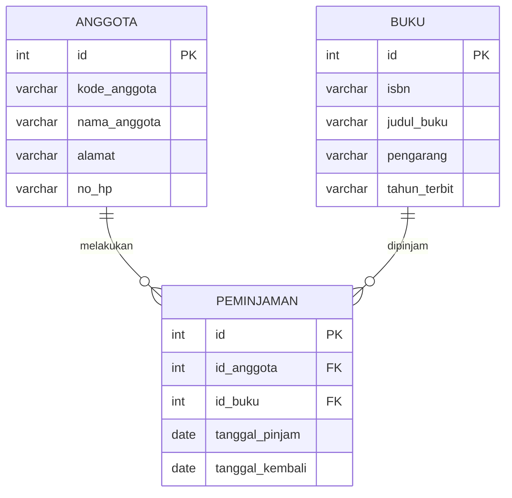

# uts_perpustkaan  
Kelompok Blackpink
Anggota Kelompok :
1. Redia Yuana Dinandika Tjandring (2511500027) : Database dan perancangan
2. Monica Trie Hapsari (2511500082) : Config, Helper, dan Endpoint A
3. Maharani Indah Saputri (2511500079) : Endpoint B (POST)
4. Chelsea Clarisa (2511500065) : Endpoint C (PUT/DELETE)

## Entity Relationship Diagram (ERD)

### Daftar Endpoint API

A. Endpoint Anggota

Method	URL	Body	Response
GET	api/anggota.php	Tidak ada	Menampilkan seluruh data anggota
GET	api/anggota.php?id=1	Tidak ada	Menampilkan anggota berdasarkan ID
POST	api/anggota.php	Data kode anggota, nama, alamat, dan no_hp	Data anggota berhasil ditambahkan
PUT	api/anggota.php?id=1	Data anggota yang diperbarui	Data anggota berhasil diubah
DELETE	api/anggota.php?id=1	Tidak ada	Data anggota berhasil dihapus

B. Endpoint Buku

Method	URL	Body	Response
GET	api/buku.php	Tidak ada	Menampilkan seluruh data buku
GET	api/buku.php?id=1	Tidak ada	Menampilkan buku berdasarkan ID
POST	api/buku.php	Data ISBN, judul buku, pengarang, dan tahun terbit	Data buku berhasil ditambahkan
PUT	api/buku.php?id=1	Data buku yang diperbarui	Data buku berhasil diubah
DELETE	api/buku.php?id=1	Tidak ada	Data buku berhasil dihapus

C. Endpoint Peminjaman

Method	URL	Body	Response
GET	api/peminjaman.php	Tidak ada	Menampilkan seluruh data peminjaman
GET	api/peminjaman.php?id=1	Tidak ada	Menampilkan peminjaman berdasarkan ID
POST	api/peminjaman.php	Data id_anggota, id_buku, tanggal_pinjam, dan tanggal_kembali	Data peminjaman berhasil ditambahkan
PUT	api/peminjaman.php?id=1	Data peminjaman yang diperbarui	Data peminjaman berhasil diubah
DELETE	api/peminjaman.php?id=1	Tidak ada	Data peminjaman berhasil dihapus

Contoh Body JSON

1. Anggota

{
  "kode_anggota": "AG006",
  "nama_anggota": "Chelsea",
  "alamat": "Pangkalpinang",
  "no_hp": "081234567890"
}

2. Buku

{
  "isbn": "9786020000000",
  "judul_buku": "Belajar Pemrograman",
  "pengarang": "Andi",
  "tahun_terbit": "2026"
}

3. Peminjaman

{
  "id_anggota": 1,
  "id_buku": 1,
  "tanggal_pinjam": "2026-11-01",
  "tanggal_kembali": "2026-11-08"
}