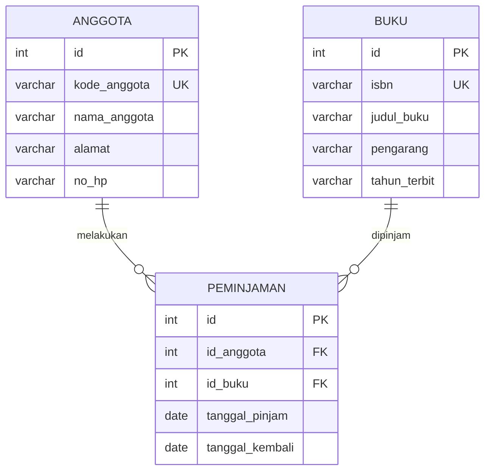

# uts_perpustkaan  
Kelompok Blackpink
Anggota Kelompok :
1. Redia Yuana Dinandika Tjandring (2511500027) : Database dan perancangan
2. Monica Trie Hapsari (2511500082) : Config, Helper, dan Endpoint A
3. Maharani Indah Saputri (2511500079) : Endpoint B (POST)
4. Chelsea Clarisa (2511500065) : Endpoint C (PUT/DELETE)

## Entity Relationship Diagram (ERD)

