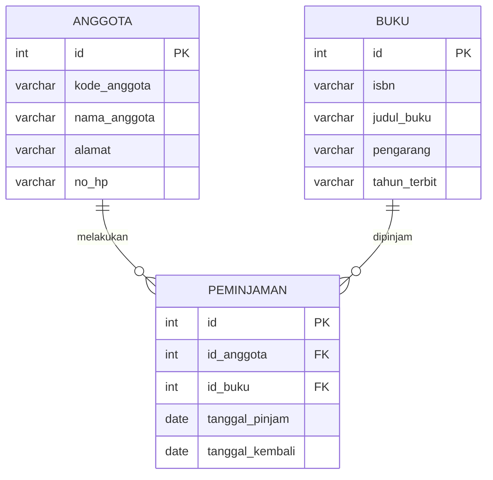

# uts_perpustakaan  
Nama Tema: Sistem Informasi Perpustakaan
Kelompok Blackpink
Anggota Kelompok :
1. Redia Yuana Dinandika Tjandring (2511500027) : Database dan perancangan
2. Maharani Indah Saputri (2511500082): Config, Helper, dan Endpoint A
3. Monica Trie Hapsari (2511500079)  : Endpoint B (POST)
4. Chelsea Clarisa (2511500065) : Endpoint C (PUT/DELETE)

## Entity Relationship Diagram (ERD)

### Daftar Endpoint API

### A. Endpoint Anggota

| Method | URL | Body | Response |
|---|---|---|---|
| GET | `anggota.php` | Tidak ada | Menampilkan seluruh data anggota |
| GET | `anggota.php?id=1` | Tidak ada | Menampilkan anggota berdasarkan ID |
| POST | `anggota.php` | Data anggota | Data anggota berhasil ditambahkan |
| PUT | `anggota.php?id=1` | Data anggota yang diperbarui | Data anggota berhasil diubah |
| DELETE | `anggota.php?id=1` | Tidak ada | Data anggota berhasil dihapus |

### B. Endpoint Buku

| Method | URL | Body | Response |
|---|---|---|---|
| GET | `buku.php` | Tidak ada | Menampilkan seluruh data buku |
| GET | `buku.php?id=1` | Tidak ada | Menampilkan buku berdasarkan ID |
| POST | `buku.php` | Data buku | Data buku berhasil ditambahkan |
| PUT | `buku.php?id=1` | Data buku yang diperbarui | Data buku berhasil diubah |
| DELETE | `buku.php?id=1` | Tidak ada | Data buku berhasil dihapus |

### C. Endpoint Peminjaman

| Method | URL | Body | Response |
|---|---|---|---|
| GET | `peminjaman.php` | Tidak ada | Menampilkan seluruh data peminjaman |
| GET | `peminjaman.php?id=1` | Tidak ada | Menampilkan peminjaman berdasarkan ID |
| POST | `peminjaman.php` | Data peminjaman | Data berhasil ditambahkan |
| PUT | `peminjaman.php?id=1` | Data peminjaman yang diperbarui | Data berhasil diubah |
| DELETE | `peminjaman.php?id=1` | Tidak ada | Data berhasil dihapus |

#### Cara Menjalankan Api menggunakan Laragon dan Thunder Client
1. Cara Menjalankan API Menggunakan Laragon dan Thunder Client
2. Buka aplikasi Laragon.
3. Klik Start All untuk menjalankan Apache dan MySQL.
4. Buka Visual Studio Code.
5. Buka folder project uts_perpustakaan.
6. Buka ekstensi Thunder Client.
7. Klik New Request.
8. Pilih method GET, POST, PUT, atau DELETE.
9. Masukkan URL endpoint API. 
Contoh : http://localhost/uts_perpustakaan/uts_perpustakaan/anggota.php
10. Jika menggunakan POST atau PUT, masukkan data pada bagian Body → JSON.
11. Klik Send untuk menjalankan dan melihat hasil response API.
